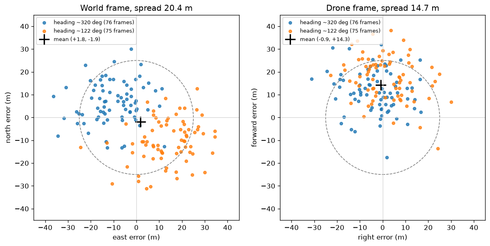
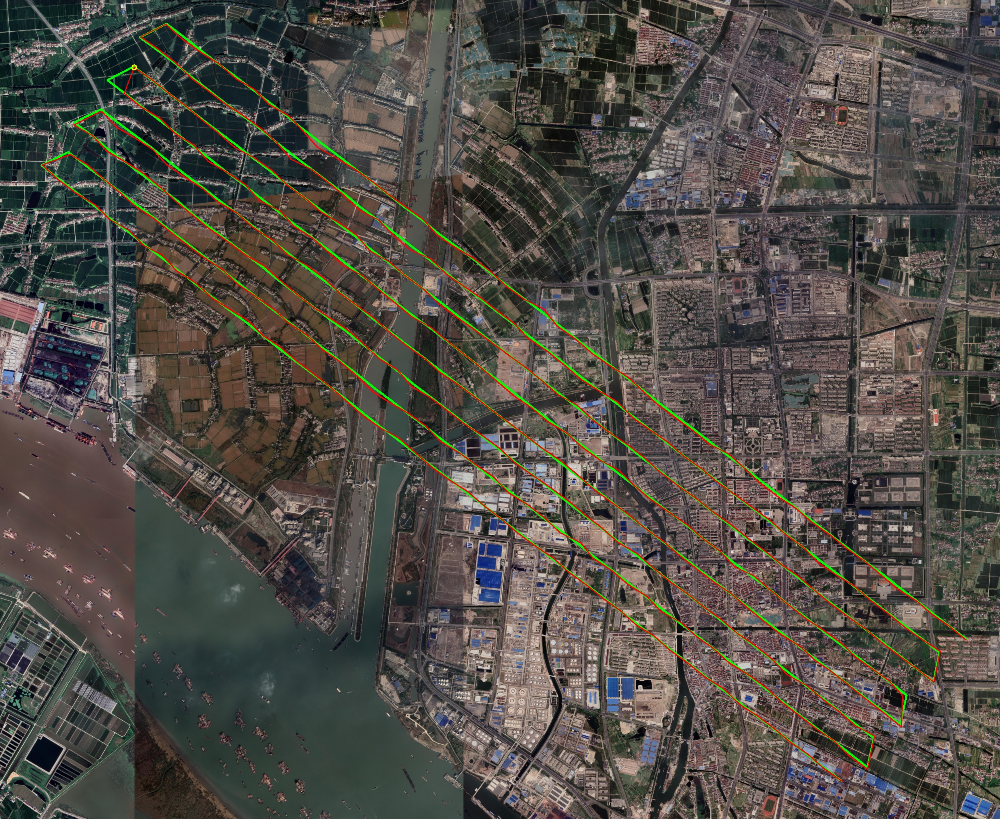
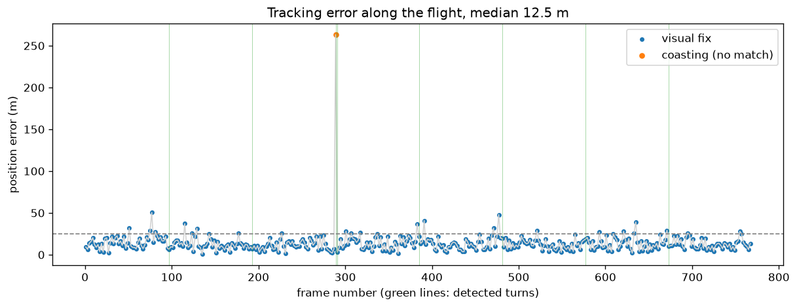

# GPS-Denied Drone Navigation by Satellite Image Matching

## Motive

Drones depend on GPS, and GPS can be jammed, spoofed or simply lost. A drone that flies over known ground can still work out where it is the way a person does with a paper map: look down, find the same roads and buildings on the map, and read off the position. This project tests how well that works on real drone flights using only a downward camera, a satellite map and the drone's own compass and altimeter.

## Objective

1. Locate a single drone photo on a satellite map and measure the error in metres against the drone's GPS log.
2. Compare a classic matcher (SIFT) with a learned one (SuperPoint + LightGlue).
3. Track a whole flight frame by frame, with no GPS in the loop.

## Dataset

[UAV-VisLoc](https://github.com/IntelliSensing/UAV-VisLoc), example subset, location 03 (Taizhou, China):

- 768 drone photos from one flight on 23 Oct 2018, at about 466 m altitude, with GPS position, altitude and compass heading for each photo
- One georeferenced satellite map covering 8.8 km x 7.3 km at about 0.25 to 0.3 m per pixel

The data is not included in this repo. The dataset page states no license, so it is used here for research and portfolio purposes only.

## Tech stack

Python, OpenCV, PyTorch, [LightGlue](https://github.com/cvg/LightGlue) (SuperPoint features), rasterio, NumPy, Matplotlib. Everything runs on a CPU laptop. No model was trained or fine-tuned: SuperPoint and LightGlue are used with their published weights.

## How it works

1. **Prepare the map.** The satellite map is resampled to 0.5 m per pixel with square pixels. The original map has pixels that are equal in degrees, which makes them 18% narrower east to west than north to south at this latitude.
2. **Prepare the drone photo.** It is rotated north-up using the compass heading and scaled to 0.5 m per pixel using the altitude and the camera's field of view.
3. **Match.** Keypoints from the drone photo are matched against a search window on the map. A similarity transform (shift, rotation, scale) is fitted with RANSAC, and the photo's centre is projected onto the map to get latitude and longitude.
4. **Check.** A match is accepted only if at least 4 points agree with the fit, the fitted scale is between 0.75 and 1.33, and the leftover rotation is under 30 degrees. Since altitude and heading are known, a correct match should need almost no extra scale or rotation, while a random wrong fit almost never passes.
5. **Track** (step 3 only). Each search window is centred on a prediction from the last position, the learned speed and the compass heading. If a frame does not match, the drone coasts on the prediction and the next window gets bigger.

**Assumptions.** Heading comes from the drone's compass and altitude from its barometer, both of which still work without GPS. The starting position is known to within 200 m, and the search window for single-frame tests is centred on a random point up to 200 m from the true position, not on the GPS itself. The camera field of view (49.2 degrees) was measured once from the first run's matched frames; a real system would take it from the camera spec. The camera is assumed to point roughly straight down.

## Results

### Single-frame localisation

Tested on 154 frames (every 5th frame, starting at frame 3) that were not used for any tuning, with a 1000 m search window. Percentages are out of all 154 frames, so a frame with no accepted match counts as a miss.

| Matcher | Within 25 m | Within 50 m | Accepted but more than 100 m off | Time per frame (CPU) |
|---|---|---|---|---|
| SIFT | 36.4% | 44.8% | 0 | about 1.3 s |
| SuperPoint + LightGlue | 74.0% | 98.1% | 0 | about 19 s |

SIFT gives no answer for more than half the frames, mostly over farmland, where the satellite image shows green fields and the October drone photos show harvested ones. LightGlue matches through that season change and places 151 of 154 frames, all within 40 m. The accept check works for both: neither matcher had a single accepted frame more than 100 m off.

Search window size matters a lot for SIFT: the same SIFT pipeline with a 1500 m window got 26.0% within 25 m.

### A consistent forward bias

With LightGlue, almost every frame lands within 50 m but only 74% within 25 m, even though each match has 150 to 300 inliers. That points to a systematic offset rather than matching noise. Splitting each error into the map's frame (east, north) and the drone's frame (forward, right) shows where it is:



In the drone's frame (right), both flight directions land on the same spot, about 14 m forward. In the map's frame (left), each direction is offset the way it was flying, so the two cancel out on average. The estimate always lands about 14.3 m ahead of the GPS log.

That could be a delay between the GPS log and the photo, or the camera being tilted forward. Wind helps tell them apart: the drone flew at 12.7 m/s going north-west and 23.8 m/s going south-east. A tilt would give the same offset in both directions, and a delay would give an offset proportional to speed. The actual offsets were 11.4 m and 17.3 m, so it is a mix. Fitting both gives roughly a 0.5 s camera-to-GPS time offset plus a fixed part of about 5 m, which would match about 0.6 degrees of forward camera pitch. With only two directions to fit, this split is an estimate rather than a measurement.

Removing it, with the offset fitted on one half of the flight and tested on the other half:

| Correction | Median error | Within 25 m |
|---|---|---|
| None | 18.2 m | 74.0% |
| Map-frame offset | 18.5 m | 71.4% |
| Drone-frame offset | 12.1 m | 91.6% |

### Tracking along the flight

The tracker flies the whole flight using every 2nd photo (384 frames, 8 flight lines and 8 turns). It starts with a position up to 200 m off, and from then on it only uses its own visual fixes, the compass and the altimeter. Frames used to fit the 14.3 m correction are flown through but left out of the scores.

| | Result |
|---|---|
| Frames with a visual fix | 306 / 307 (99.7%) |
| Within 25 m | 92.2% |
| Within 50 m | 99.3% |
| Median error | 12.5 m |
| Re-localisations needed | 0 |
| Time per frame (CPU) | about 14 s |



Green is the GPS log and red is the tracked path. The one miss was the first photo after the 4th turn, which coasted with a 263 m error and locked back on at the next photo with 3 m.



**The first version failed, and why.** The first tracker predicted each position as "last position + speed x time gap, along the compass heading". It tracked the first two flight lines and then lost the drone for good at the second turn, ending up 29 km off. Looking at the GPS log showed two problems:

- At each turn, the drone spends about 46 s turning and moves only about 240 m sideways to the next line. The tracker multiplied its speed by the whole 46 s and pushed the prediction 600 to 1,400 m along the new heading, outside the search window.
- Because of wind, the drone flies at 13.5 m/s one way and 23.7 m/s the other, and points up to 13 degrees away from where it is actually going. The tracker carried the speed from one line into the next, so its prediction drifted by about 150 m per step.

The second version fixes these using only information a drone has without GPS:

- Velocity is learned as a 2D vector from the last two visual fixes, so it includes wind drift and the different speed in each direction. This also cut the typical prediction error from 35 m to 22 m.
- A heading change of more than 60 degrees on the compass marks a turn. The old velocity is dropped and the search is centred on the last known position with a larger window.
- The search window always stays inside the map.
- After 3 missed frames in a row, the drone searches a 3 km area in tiles to find itself again. It was not needed on this flight, but it means one bad prediction is no longer fatal.

## Project structure

```
gps-denied-nav/
├── scripts/
│   ├── geo_utils.py            shared helpers: CSV loading, lat/lon to pixel, map cache
│   ├── 01_check_data.py        sanity checks, flight path overlay, heading direction check
│   ├── 02_sift_baseline.py     single-frame localisation with SIFT
│   ├── 02b_accept_sweep.py     re-scores results with different accept thresholds
│   ├── 03_lightglue.py         single-frame localisation with SuperPoint + LightGlue
│   ├── 03b_error_analysis.py   finds systematic offsets in the errors
│   ├── 04_track.py             tracking along the whole flight
│   └── 04b_turn_check.py       GPS log check around the turns
├── assets/                     images used in this README
├── data/                       dataset goes here (not in the repo)
├── outputs/                    results, created by the scripts (not in the repo)
└── requirements.txt
```

## Setup

```
git clone https://github.com/AKASH4145/gps-denied-nav.git
cd gps-denied-nav
pip install torch torchvision --index-url https://download.pytorch.org/whl/cpu
pip install -r requirements.txt
```

Download the UAV-VisLoc example subset from the dataset page and unzip it into `data/`, so that you have `data/03/drone/`, `data/03/satellite03.tif`, `data/03/03.csv` and the satellite coordinates CSV in `data/`.

## Usage

Run from the project root. The first run of any matching script builds a 0.5 m map cache in `data/cache/`, which takes a couple of minutes.

```
python scripts/01_check_data.py --frame 300
python scripts/02_sift_baseline.py --offset 2 --search-m 1000
python scripts/03_lightglue.py --offset 2
python scripts/02b_accept_sweep.py --stage 03_lightglue --tag superpoint_mpp0.5_s1000_off2
python scripts/03b_error_analysis.py
python scripts/04_track.py
```

`--offset 2` selects the held-out frames. `--max-frames 10` is useful for a quick test.

## Limitations

- One location and one flight, all on the same day. The 14 m bias is fitted and tested within that flight.
- About 19 s per frame on CPU (14 s while tracking) is far from real time. SuperPoint and LightGlue run in tens of milliseconds on a GPU or Jetson.
- The tracker was tuned while looking at this flight's turns. Its settings (turn threshold, window sizes) still need testing on other flights.
- SuperPoint's weights are licensed for non-commercial use only. `--features disk` switches to DISK, which has a permissive license.
- The satellite map is a mosaic of images taken on different dates, and tall buildings shift position in the drone photo depending on where they are in the frame. Both add error that a 2D transform cannot remove.

## Future plans

- Run on all 11 locations of the full dataset, and check whether the same 14 m forward bias appears on other flights.
- Replace the fixed 14.3 m correction with a fixed part plus a time offset multiplied by the tracker's own speed estimate.
- Fuse visual fixes with IMU data in a Kalman filter instead of the simple predict-and-match loop.
- Fine-tune LightGlue on drone-to-satellite pairs, and compare against LoFTR.
- Test on VPAIR, which has more accurate ground truth.